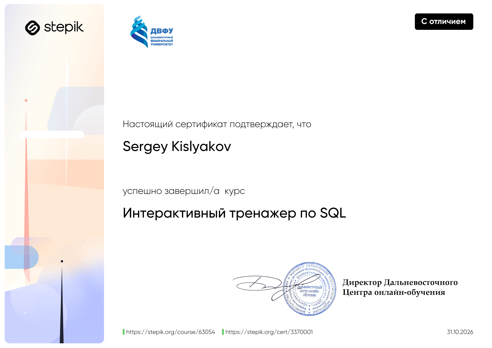

  <picture>
    <source media="(prefers-color-scheme: dark)" srcset="https://readme-typing-svg.herokuapp.com?font=Fira+Code&size=28&duration=2500&pause=1000&color=58A6FF&center=true&vCenter=true&width=700&lines=Python+Backend+%2F+Full-Stack+Developer;Django+%7C+DRF+%7C+FastAPI+%7C+PostgreSQL+%7C+Redis;Telegram+%26+VK+Bots+%7C+aiogram+%7C+CI%2FCD" />
    
  </picture>

  <h2>Python Backend / Full-Stack Developer</h2>

  
  
  
  

---

## About Me

- 👋 I design and ship Python web services and bots — from data model and API to CI/CD and production deployment.
- 🔭 Currently working at **EFKO**.
- 📍 Based in **Ostrogozhsk, Russia** — open to remote.
- 💼 **Open to work / collaboration** — the fastest way to reach me is [Telegram](https://t.me/kislyakow).

---

## Tech Stack

**Core** — the tools I'm ready to discuss in depth at a technical interview:

**Also used** in day-to-day work and projects:

---

## Selected Projects

The two flagship projects are broken down below; here are the rest.

| Project | Description | Stack |
|---|---|---|
| [dossier](https://github.com/skislyakow/dossier) | Portfolio site with auto-generated PDF résumé and CI/CD deploy · [live](https://kislyakov.pro) | Django, WeasyPrint, Nginx, GitHub Actions |
| [BeautyCity](https://github.com/skislyakow/BeautyCity) | Beauty-salon booking: server-side slot calculation, SMS login, YooKassa, staff stats · [demo](https://beauty.kislyakov.pro) | Django, DRF, YooKassa |
| [star-burger](https://github.com/skislyakow/star-burger) | Food-delivery storefront: React cart, manager dashboard, geocoding · [demo](https://star-burger.kislyakov.pro) | Django, DRF, React, PostgreSQL, CI |
| [FishShop](https://github.com/skislyakow/FishShop) | Telegram seafood shop backed by a headless Strapi CMS, Redis FSM | python-telegram-bot, Strapi, Redis |
| [opencode-py](https://github.com/skislyakow/opencode-py) | Python SDK for the Opencode AI coding agent (typed, streaming, async) | Pydantic, httpx |

Also: **fastai-api** (AI site generator REST API), **ferma** (Telegram/VK channel automation), **support-bot** (Dialogflow support bot), **Devman-monitor** (systemd watchdog) — see [all repositories](https://github.com/skislyakow?tab=repositories).

---

## ⭐ Featured Projects

### 🗄️ SelfStorage — storage rental with online payments
> Django service: pick a warehouse and a box, pay online, get a QR code for the door.

- 🧭 **Multi-step checkout** — `SessionWizardView` with server-side validation on every step, promo codes with date windows and per-month price calculation.
- 💳 **Payments without duplicates** — one `Payment` per order via `get_or_create`; the webhook and the `return_url` both go through one idempotent `_mark_paid` guarded by status checks, so a repeated webhook never re-sends emails or regenerates the QR.
- 🔒 **No double booking** — the box is re-checked as `free` on every step and set to `reserved` when the order is created.
- 🔑 **Access & lifecycle** — QR door codes, in-app notification feed, reminder emails (30/14/7/3 days before the end, plus overdue).
- 📊 **Owner dashboard** — occupancy, orders and revenue; CI gate with ruff + mypy.

🔗 [github.com/skislyakow/SelfStorage](https://github.com/skislyakow/SelfStorage) · [live demo](https://selfstorage.kislyakov.pro)

### 🧠 quiz-bot — multi-platform quiz bot
> Quiz bot for Telegram & VK on a base of ~300k questions.

- 🤖 **Two platforms, one logic** — Telegram (aiogram) + VK (vkbottle) as independent processes sharing common modules.
- ⚡ **Fast startup** — ~302k-question cache with fingerprint-based auto-invalidation; O(1) random pick.
- 🧠 **Smart answer matching** — pymorphy3 lemmatization, punctuation normalization, partial-match tolerance.
- 🗄️ **Resilient state** — FSM in Redis with TTL; graceful degradation if Redis is down.

🔗 [github.com/skislyakow/quiz-bot](https://github.com/skislyakow/quiz-bot)

---

## 📜 Certifications

<table>
  <tr>
    <td width="45%" align="center">
      
    </td>
    <td>
      <b>Интерактивный тренажер по SQL</b> — <i>с отличием</i> 
      Stepik · hands-on SQL practice: SELECT, JOINs, subqueries, aggregation
        
      <a href="https://stepik.org/cert/3370001">Verify on Stepik</a> · <a href="https://stepik.org/course/63054">Course page</a>
    </td>
  </tr>
</table>

---

## 📊 GitHub at a glance

  
  
  
  
  

  <picture>
    <source media="(prefers-color-scheme: dark)" srcset="https://raw.githubusercontent.com/skislyakow/skislyakow/output/github-contribution-grid-snake-dark.svg" />
    
  </picture>

